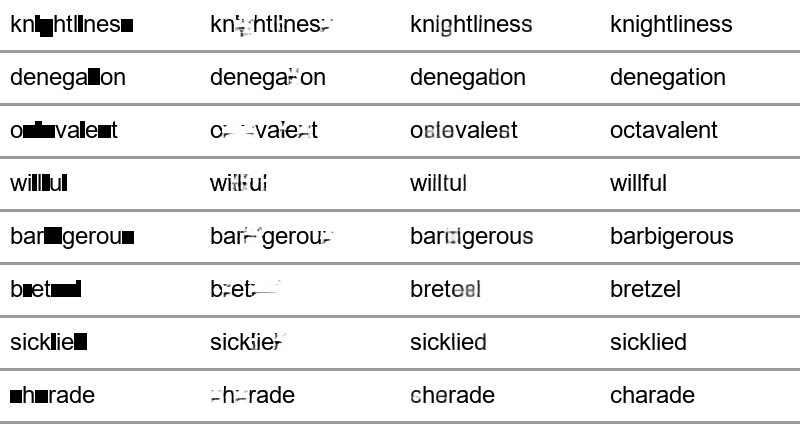

# 가려진 영어 단어 이미지 복원

영어 단어 이미지에서 일부 글자가 가려졌을 때, 가려진 부분을 복원하는 딥러닝 모델입니다.

- **2024 버전**: Keras Conv 오토인코더 (`deeplearning.py`, `autoencoder_model.h5`, `result.py`)
- **2026 버전**: PyTorch `WordInpainter` (`inpaint/`, `train.py`, `app.py`, `word_inpainter.pt`)

2024 버전 파일은 그대로 두었습니다.

## 2026 버전에서 바뀐 점

| | 2024 Autoencoder | 2026 WordInpainter |
|---|---|---|
| 프레임워크 | TensorFlow/Keras | PyTorch |
| 구조 | Conv 5층, 스킵 연결 없음 | ConvNeXt U-Net + Transformer 병목 + 고해상도 refine |
| 마스크 정보 | 없음 (어디가 가려졌는지 모름) | 마스크 채널 입력 → 가려진 곳만 복원, 나머지는 원본 유지 |
| 문맥 이용 | 3x3 conv 의 좁은 시야 | Transformer 가 단어 전체를 보고 가려진 글자 추론 |
| 글자 인식 | 없음 | CTC 보조 헤드: 학습 중 단어 읽기를 함께 배우고, 추론 시 읽은 단어를 출력 |
| 손실 | BCE | 마스크 가중 BCE + 마스크 L1 + CTC |
| 학습 | 5 epoch, Adam | AdamW + warmup/cosine, EMA 가중치, gradient clipping, drop-path |
| 데이터 | 디스크에 저장한 고정 이미지 1세트 | 매 스텝 새로 합성 (여러 폰트·크기·위치·노이즈·블러, 글자/임의 사각형 마스크) |
| 마스크 위치 | 글자 bbox 폭을 더해서 계산 → 실제 글자와 어긋남 | 실제 렌더링 좌표(`textlength`/`textbbox`)로 정확히 계산 |
| 평가 | 없음 | 단어 단위 train/val/test 분리, 처음 보는 단어로 평가 |
| 입력 크기 | 200x50 고정 (GUI 에서 선택 영역을 늘려서 넣음) | 아무 크기 → 비율 유지로 맞춘 뒤 원래 해상도로 되돌림 |

## 사용법

```bash
pip install -r requirements.txt

python app.py                                  # GUI: 이미지 열기 → (검은 상자 자동 선택 / 드래그) → 복원
python restore.py 입력.png --box 40 5 90 45     # 명령줄 복원 (box 는 여러 개 가능)
python restore.py --demo hello                  # 데모 단어로 바로 테스트
python evaluate.py                              # 2024 vs 2026 비교 + comparison.png
python train.py --steps 20000 --batch 64        # 다시 학습 (GPU 있으면 자동 사용)
```

## 결과

**학습**: Windows 노트북 GPU, 배치 128, 30,000 스텝 (약 4시간), 파라미터 1.67M.
`python train.py --steps 30000 --batch 128 --workers 4`

**평가**: 학습에 쓰지 않은 test 단어 1,000개 (`python evaluate.py`, 학습한 PC 에서 실행).

**2024 방식 데이터** (Arial, 고정 위치, 글자 단위 가림 — 2024 모델이 학습한 조건 그대로)

| 모델 | 가려진 영역 L1 ↓ | PSNR ↑ | 가려진 영역 픽셀 정확도 ↑ | 단어 전체 정답률 ↑ |
|---|---|---|---|---|
| 2024 Autoencoder | 0.380 | 19.74 | 0.603 | – |
| 2024 Autoencoder (+마스크 합성) | 0.380 | 19.94 | 0.603 | – |
| **2026 WordInpainter** | **0.167** | **26.97** | **0.836** | **40.1%** |

**증강 데이터** (다양한 폰트/위치/노이즈/임의 사각형)

| 모델 | 가려진 영역 L1 ↓ | PSNR ↑ | 가려진 영역 픽셀 정확도 ↑ | 단어 전체 정답률 ↑ |
|---|---|---|---|---|
| 2024 Autoencoder | 0.249 | 15.81 | 0.777 | – |
| 2024 Autoencoder (+마스크 합성) | 0.249 | 21.36 | 0.777 | – |
| **2026 WordInpainter** | **0.066** | **32.29** | **0.927** | **52.9%** |

단어 전체 정답률은 CTC 헤드가 읽은 단어가 정답과 완전히 같은 비율입니다 (한 글자라도 틀리면 오답).

 (왼쪽부터: 입력 | 2024 | 2026 | 정답)

### 학습 과정 (검증 단어 1,024개)

| 스텝 | masked L1 ↓ | PSNR ↑ | 단어 정답률 ↑ |
|---|---|---|---|
| 1,000 | 0.116 | 27.7 | 0% |
| 3,000 | 0.093 | 29.4 | 3.0% |
| 5,000 | 0.088 | 29.9 | 23.0% |
| 7,000 | 0.084 | 30.3 | 34.7% |
| 30,000 | 0.067 | 32.2 | 51.1% |

글자 인식(CTC)은 약 3,000 스텝까지 0% 에 머물다가 그 뒤 빠르게 올라갑니다.
CPU 로 짧게 학습하면 이 단계에 도달하지 못합니다.

### 한계

- **학습에 없던 폰트에는 약합니다.** 같은 모델을 Windows 폰트가 없는 Linux(DejaVu, FreeSans 등)에서
  평가하면 증강 데이터 단어 정답률이 52.9% → 36.0%, PSNR 이 32.3 → 29.5 로 떨어집니다.
  학습할 때 쓰인 폰트는 `inpaint/data.py` 의 `FONT_CANDIDATES` 중 그 PC 에 설치된 것들입니다.
- 가려진 글자를 또렷하게 그리지만, 다른 글자로 그리는 경우가 있습니다 (예: willful → willtul).
- 학습률 스케줄이 끝까지 진행된 뒤에도 지표가 오르고 있었으므로, 더 긴 학습이나 더 큰 모델로 개선될 여지가 있습니다.
- `데이터전처리.py` (2024) 에서 가린 상자는 실제 글자 위치와 어긋나 있었습니다 (x 좌표를 글자 bbox 폭의 합으로 계산).
